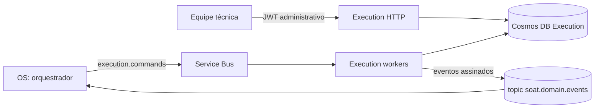

# soat-execution-service

**Execution Service** da Fase 4 do Sistema Integrado de Oficina. É responsável
por catálogo técnico, estoque por filial, diagnóstico, reserva de peças, fila de
execução e reparo, e comunica a finalização ao
[OS Service](https://github.com/JoaoGW/soat-api) pela Saga orquestrada.

## Stack

- Node.js 24, TypeScript e NestJS;
- Azure Cosmos DB for NoSQL exclusivo do serviço, particionado por filial;
- Azure Service Bus (comandos, eventos, inbox e outbox) com assinatura Ed25519;
- Workload Identity, OpenTelemetry/New Relic, Jest, SonarJS, Docker,
  Kustomize e kind.

## Arquitetura



O banco NoSQL foi escolhido porque estoque, reservas, tarefas e diagnóstico são
documentos lidos e alterados sempre dentro da mesma filial. A partição por filial
permite batches transacionais com ETag para concorrência otimista, gravando
estoque, reserva, operação, inbox e outbox atomicamente, e escala com o número
de filiais da rede. Nenhum outro serviço acessa o Cosmos de Execution.

## Saga orquestrada

O OS coordena uma **Saga orquestrada** por comandos e eventos assinados. A
orquestração mantém em um único dono os prazos, a regra de pagamento antes do
reparo e a ordem das compensações; Execution apenas executa comandos
idempotentes e publica fatos, sem conhecer Billing.

| Comando recebido | Eventos emitidos |
| --- | --- |
| `execution.request-diagnosis.v1` | diagnóstico pendente; `diagnosis-started` e `diagnosis-completed` (itens e preços fixados do catálogo) pelas rotas da equipe |
| `execution.reserve-parts.v1` | `parts-reserved`, `parts-reservation-failed` |
| `execution.enqueue-work.v1` | `work-enqueued`; depois `work-started` e `work-completed` pelas rotas da equipe |
| `execution.cancel-work.v1` | `work-cancelled` (evidência de não início) |
| `execution.release-parts.v1` | `parts-released` |

Execution reserva peças após aprovação e só enfileira o reparo após comando
vinculado ao pagamento confirmado. Na compensação, confirma o cancelamento antes
de qualquer liberação: o cancelamento antes do início grava uma barreira
durável; depois do início retorna `ALREADY_STARTED` e a ocorrência segue para
reconciliação, sem rollback físico fictício. A liberação exige o cancelamento
confirmado e nenhuma tarefa iniciada. Os schemas estão em
[`docs/contracts/messages`](docs/contracts/messages).

## API REST

A referência está em [`docs/openapi.yaml`](docs/openapi.yaml) e é validada por
teste contra as rotas. Todas as rotas, exceto `/health`, exigem JWT
administrativo HS256 do OS (`JWT_SECRET`, distinto de `JWT_CLIENT_SECRET`).

| Rota | Uso |
| --- | --- |
| `GET /execucoes/fila?filialId=&limit=` | Fila `QUEUED` da filial em ordem de entrada, paginada por `continuationToken` (máx. 100) |
| `POST /execucoes/:osId/iniciar-diagnostico` e `/concluir-diagnostico` | Diagnóstico; a conclusão recebe `items` e fixa os preços do catálogo em centavos |
| `POST /execucoes/:osId/iniciar` e `/finalizar` | Início (consome a reserva) e conclusão do reparo |
| `GET` e `PUT /estoque/:filialId/:sku` | Saldo, reservado e disponível; ajuste absoluto auditado |
| `GET`, `PUT` e `DELETE /catalogo/:filialId/:itemType/:sourceId` | Item do catálogo da filial e desativação lógica |
| `GET /catalogo/:filialId/:itemType` | Listagem paginada de itens ativos |

As ações exigem `Idempotency-Key`; repetições retornam o resultado original.

## Configuração

Copie `.env.example`. O acesso ao Cosmos usa exclusivamente Workload Identity
(`AZURE_TENANT_ID`, `AZURE_CLIENT_ID`, `AZURE_FEDERATED_TOKEN_FILE`) com
`COSMOS_ENDPOINT`, `COSMOS_DATABASE` e `COSMOS_CONTAINER`; sem essa
configuração as rotas de dados respondem 503. Os workers ficam desativados por
padrão:

| Variável | Habilita |
| --- | --- |
| `ENABLE_EXECUTION_COMMANDS` | Consumidor da fila `SERVICE_BUS_COMMAND_QUEUE` |
| `ENABLE_EXECUTION_OUTBOX` | Publicação da outbox no `SERVICE_BUS_EVENT_TOPIC`, com lease, ETag e cinco tentativas |

Ao habilitar os workers, configure `OS_MESSAGE_PUBLIC_KEY` e a chave privada
exclusiva `EXECUTION_MESSAGE_PRIVATE_KEY`; comandos sem assinatura válida seguem
à DLQ antes do processamento. A indexação do caminho `queueKey` é necessária no
Cosmos. Tarefas de versões anteriores sem `queueKey` são corrigidas por filial
com `QUEUE_BACKFILL_FILIAL=<filial> npm run ops:backfill-queue` (inspeção) e
`-- --apply` (gravação com ETag).

## Execução e testes

Com Node 24:

```bash
npm ci
npm run lint
npm run quality:sonarjs
npm run build
npm run test:cov
npm run test:coverage-infrastructure
npm run test:contracts
```

`npm run test:cosmos-queue` exige `COSMOS_TEST_ENDPOINT=http://127.0.0.1:8081`
(emulador Cosmos) e usa um banco temporário: consulta fila, estoque e catálogo
pelas rotas HTTP e valida as respostas contra o OpenAPI. O fluxo completo com os
três serviços é o BDD distribuído do
[OS](https://github.com/JoaoGW/soat-api#testes-cobertura-e-qualidade).

### Evidência de cobertura

Medição do [CI](https://github.com/JoaoGW/soat-execution-service/actions/workflows/ci.yml) no commit `b60da54`, com gate mínimo de 80% em cada métrica:

| Escopo | Statements | Branches | Functions | Lines |
| --- | --- | --- | --- | --- |
| Serviço | 89.28% | 83.98% | 94.00% | 95.16% |
| Infraestrutura | 91.03% | 84.37% | 98.03% | 96.75% |

Cada execução publica os totais do próprio SHA no resumo do job e como anotação (`scripts/quality/coverage-summary.cjs`) e anexa o relatório completo como artefato.

`npm run quality:sonarjs` aplica regras selecionadas do analisador SonarJS
(SonarSource) para lógica e segurança com `--max-warnings=0`; é o gate de
qualidade similar ao SonarQube adotado no CI, sem o painel do SonarQube.

## CI/CD e deploy

O [CI](https://github.com/JoaoGW/soat-execution-service/actions/workflows/ci.yml)
roda em todo pull request e em push para `main` e `development`:

1. **quality**: lint, SonarJS, build, observabilidade local, cobertura do
   serviço e da infraestrutura (80% por métrica), contratos, imagem com a trava
   da recuperação e manifests;
2. **Deploy Kubernetes (kind)**: cria um cluster kind efêmero, carrega a imagem
   do SHA e aplica o overlay
   [`deploy/kustomize/overlays/kind`](deploy/kustomize/overlays/kind); valida
   rollout, imagem, `/health`, rota sem token (401) e token administrativo
   aceito com o acesso ao Cosmos fechado sem identidade Azure (503);
3. **publish** e **deploy_hml**: em push para `development`, publicam no GHCR e
   aplicam no AKS o mesmo SHA, somente com `HML_DEPLOY_ENABLED=true`.

A `main` exige pull request e os checks. O deploy AKS usa OIDC
(`AZURE_CLIENT_ID`, `AZURE_TENANT_ID`, `AZURE_SUBSCRIPTION_ID`), nomes do AKS,
`EXECUTION_WORKLOAD_CLIENT_ID` e os secrets `soat-ghcr-pull` e
`soat-execution-runtime`. Enquanto a assinatura Azure estiver desativada, o
ambiente kind é o deploy automatizado verificável.

## Observabilidade

Traces e métricas OpenTelemetry são exportados ao New Relic, como na Fase 3:
`OBSERVABILITY_ENABLED=true`, `NEW_RELIC_LICENSE_KEY` no secret,
`OTEL_SERVICE_VERSION` com o SHA e `OTEL_EXPORTER_OTLP_ENDPOINT` opcional. A
instrumentação inicia antes do Nest, propaga o contexto W3C nas mensagens e é
encerrada no shutdown. `npm run build && npm run test:observability-local`
verifica a exportação para um coletor local.

## Operação

A publicação é pelo menos uma vez: após falha de confirmação, o mesmo
`messageId` pode ser reenviado. Eventos que esgotam as tentativas ficam em
`FAILED`; o [procedimento de recuperação](docs/recuperacao-outbox.md) rearma
eventos próprios com auditoria transacional na mesma partição
(`npm run ops:recover-outbox`, travado sem habilitação explícita).

## Dependências

O `package-lock.json` fixa Multer 2.5.0 por `overrides` para corrigir o aviso
GHSA-q7qp-rjg7-q26m na versão transitiva fixada pelo Nest; um teste exercita o
interceptor HTTP com filtro assíncrono. Remova o override quando uma versão
compatível do Nest incorporar a correção.
